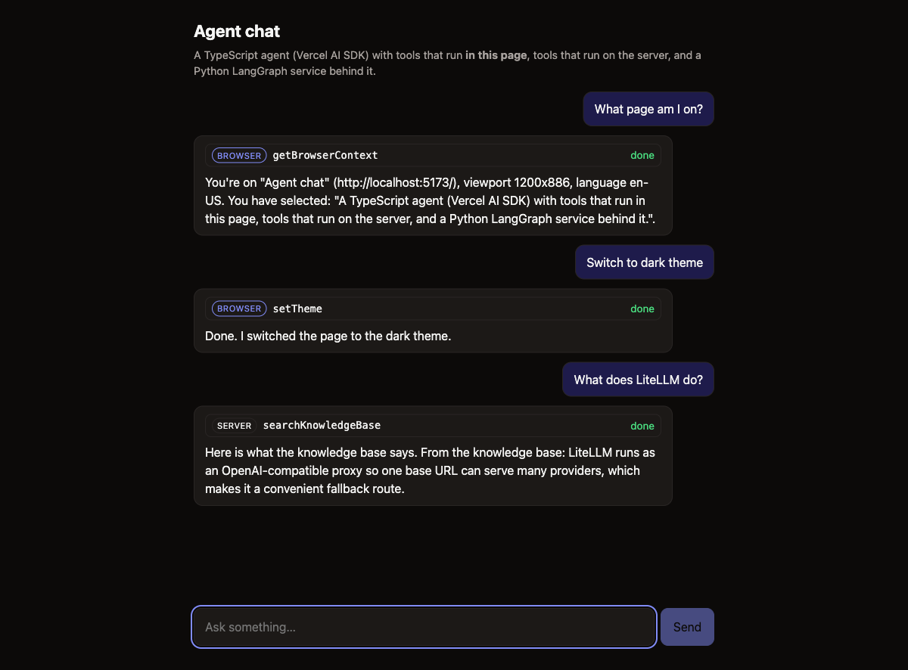

# Week 15 project -- TypeScript agent layer (Vercel AI SDK 7) over a Python LangGraph service

Three small pieces (a Python service, a TypeScript agent layer, and two clients -- a browser page and a terminal):

```
browser page (web/, useChat) --+
                               +--SSE--> ts-agent (Hono + ai@7) --HTTP/SSE--> python-service (FastAPI + LangGraph)
terminal client ---------------+              |
                                              +--> OpenAI (primary) / a second model via LiteLLM (optional fallback)
```

| Piece | Where | What it does |
|---|---|---|
| LangGraph service | `python-service/app/` | `retrieve -> generate` graph; `POST /v1/stream` (SSE: `step` / `token` / `done` / `error`), `POST /v1/ask`. Uses a deterministic streaming demo model unless `OPENAI_API_KEY` is set |
| Providers + fallback | `ts-agent/src/models.ts` | OpenAI primary (`@ai-sdk/openai`); optional LiteLLM (OpenAI-compatible) fallback as a `wrapLanguageModel` middleware |
| Tools | `ts-agent/src/tools.ts` | `searchKnowledgeBase` (calls the Python service), `getCurrentTime`; zod schemas |
| API routes | `ts-agent/src/app.ts` | `POST /api/langgraph/stream` (pass-through, no LLM) and `POST /api/agent` (`streamText` + tools + `isStepCount`) |
| LangGraph client | `ts-agent/src/langgraphClient.ts`, `src/sse.ts` | SSE parsing, zod-validated events, abort propagation |
| Browser UI | `web/src/App.tsx` | Vite + React page using `useChat` against `/api/agent`; streams text, shows each tool call with a **browser** / **server** badge, restores the chosen theme on reload |
| Browser-side tools | `web/src/clientTools.ts` (declared in `ts-agent/src/tools.ts` as `clientTools`) | `getBrowserContext` (URL, title, language, viewport, capped selection) and `setTheme`; they run **in the page**, input is zod-validated |
| Terminal client | `ts-agent/src/client.ts` | prints deltas as they arrive; shows tool calls and steps; reports first-text vs total time |
| Offline demo model | `ts-agent/src/demoModel.ts` | scripted stand-in for a real model (`MOCK_MODEL=1`): calls a tool, then streams an answer |

Read [`../concept.md`](../concept.md) first.

## Install and test

```bash
# Python service (6 tests)
cd python-service && uv sync && uv run pytest -q

# TypeScript layer (56 tests, no network, no keys; needs Node >= 20)
cd ../ts-agent && npm install && npm run typecheck && npm test

# Browser app (14 tests for the browser tools; `npm run build` typechecks and bundles)
cd ../web && npm install && npm run typecheck && npm test && npm run build
```

The TS tests use the SDK's `MockLanguageModelV4` and a fake LangGraph client. Notable ones:
the first token must reach the client **before the upstream finishes** (a gated upstream deadlocks
a buffering implementation -- verified by temporarily buffering and watching it fail); client
disconnect cancels the upstream request; the tool loop feeds results back and is bounded by
`maxSteps`; fallback is used before the first token but **not** mid-stream or on abort.

## Run it (offline, no API keys)

```bash
# terminal 1 -- Python LangGraph service on :8000
cd python-service && uv run uvicorn app.main:create_app --factory --port 8000

# terminal 2 -- TS agent layer on :3000 with the scripted demo model
cd ts-agent && MOCK_MODEL=1 npm run dev

# terminal 3 -- the browser UI on http://localhost:5173 (Vite proxies /api to :3000)
cd web && npm run dev
#   try: "What page am I on?" (browser tool; select some text first!),
#        "Switch to dark theme" (browser tool that changes the page),
#        "What does LiteLLM do?" (server tool -> Python LangGraph)

# or terminal 3 -- the streaming terminal client
cd ts-agent
npm run client -- "How does the AI SDK stream text?"                    # LangGraph pass-through
npm run client -- --mode agent "What does LiteLLM do?"                  # tool-calling agent
```

Expected: text appears word by word; the footer shows e.g.
`25 text deltas | first text at 93ms | total 1196ms`. In `--mode agent` you also see
`tool call: searchKnowledgeBase(...)` and `tool result: ...` before the answer.

## Run it with real models

```bash
cd ts-agent && cp .env.example .env     # then put your key in .env (loaded automatically; shell variables win)
#   OPENAI_API_KEY=sk-...       primary; OPENAI_MODEL defaults to gpt-4o-mini
#   LITELLM_API_KEY=...         OPTIONAL fallback via a LiteLLM proxy:  litellm --model gpt-4o --port 4000
npm run dev                      # startup log shows which model(s) are active
```

With no `LITELLM_API_KEY`, OpenAI runs alone (no fallback) -- that is the normal setup if you only have
an OpenAI key. For the Python side, put the same `OPENAI_API_KEY` in `python-service/.env` to replace
the demo model with a real streaming one. (The original plan used Claude Sonnet as primary; it was
swapped for OpenAI because no Anthropic key was available. Going back is a one-function change in
`ts-agent/src/models.ts`: use `createAnthropic` from `@ai-sdk/anthropic` instead of `createOpenAI`.)



> Status: all three test suites and the offline end-to-end run (client -> TS -> Python, both routes) pass.
> The browser UI was also driven in a real Chromium (Playwright) against all three servers: both
> browser tools ran in the page and the conversation auto-resumed, the selection was captured, the
> theme applied and survived a reload, and a server tool worked in the same conversation (so earlier
> browser tool results re-sent in the history were accepted).
> **Not run against live providers** (no key was available while building): OpenAI, LiteLLM, and the
> real-model Python path are covered only by mock-model tests. What *was* checked without a real key:
> the server starts and picks OpenAI from `.env`, a shell variable overrides the file, and a bad key
> reaches the client as a masked error with details in the server log. Not yet seen: whether a real
> model chooses the browser tools sensibly (the offline demo model picks tools from keywords). To
> check, set `OPENAI_API_KEY`, run the three servers without `MOCK_MODEL`, and try the three
> suggested prompts in the browser; to check fallback, also set `LITELLM_API_KEY`, break the OpenAI
> key, and watch for the `[models] primary failed, using fallback` log line. Record results in
> `../notes.md`. Note the Python demo model's answers are canned ("From the knowledge base: ...").
